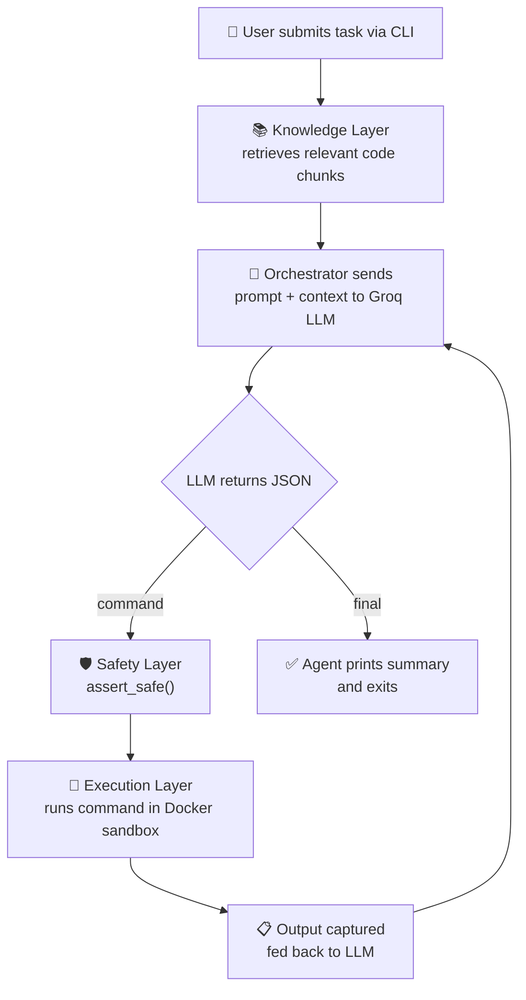

<p align="center">
  
  
  
  
  
</p>

<h1 align="center">🤖 CodingAgent</h1>

<p align="center">
  <b>Autonomous Coding Agent</b> — inspired by the <a href="https://www.youtube.com/watch?v=53oCZwvjs6o">Claude Code System Design</a> architecture.<br/>
  A layered, CLI-first agent that inspects, edits, and tests code inside a sandboxed Docker container<br/>
  using <b>Groq LLMs</b> through the <b>OpenAI-compatible Python SDK</b>.
</p>

---

## 📐 Architecture — The 6 Layers

This project follows the **Claude Code system design** interview pattern, split into clearly named layers:

```
 ┌─────────────────────────────────────────────────────────┐
 │  1. CLI / Entry Point          (pyproject.toml → main)  │
 ├─────────────────────────────────────────────────────────┤
 │  2. Safety & Permission Gate   (layers/safety.py)       │
 ├─────────────────────────────────────────────────────────┤
 │  3. Orchestrator / Agent Loop  (layers/orchestrator.py) │
 │     Plan → Act → Observe → Repeat                      │
 ├─────────────────────────────────────────────────────────┤
 │  4. Knowledge & Context        (layers/knowledge.py)    │
 │     TF-IDF retrieval over repo chunks                   │
 ├─────────────────────────────────────────────────────────┤
 │  5. Execution & Tool Dispatch  (layers/execution.py)    │
 │     Docker sandbox: no network, caps dropped            │
 ├─────────────────────────────────────────────────────────┤
 │  6. Integration / External     (Groq via OpenAI SDK)    │
 │     https://api.groq.com/openai/v1                      │
 └─────────────────────────────────────────────────────────┘
```

| # | Layer | File | Responsibility |
|---|-------|------|----------------|
| 1 | **CLI / Entry** | `pyproject.toml` → `layers/orchestrator.py:main` | Parses args, boots the agent |
| 2 | **Safety & Permissions** | `layers/safety.py` | Blacklist patterns, `assert_safe()` gate |
| 3 | **Orchestrator** | `layers/orchestrator.py` | Master loop — calls LLM, dispatches tools |
| 4 | **Knowledge & Context** | `layers/knowledge.py` | TF-IDF retrieval from workspace files |
| 5 | **Execution & Sandbox** | `layers/execution.py` | Runs commands in a locked-down Docker container |
| 6 | **Integration** | OpenAI SDK → Groq | LLM inference via the OpenAI-compatible endpoint |

---

## ⚡ Quick Start

### Prerequisites

| Requirement | Version |
|-------------|---------|
| Python | 3.11+ |
| Docker Engine | Running and accessible |
| Groq API Key | [Get one free →](https://console.groq.com) |

### 1 · Clone & Install

```bash
git clone <your-repo-url> && cd CodingAgent

# Create a virtual environment
python -m venv .venv
source .venv/bin/activate        # Linux / macOS
# .venv\Scripts\activate         # Windows

# Install in editable mode
pip install -e .
```

### 2 · Build the Sandbox Image

```bash
docker build -f Dockerfile.sandbox -t coding-sandbox:local .
```

### 3 · Configure Environment

```bash
cp .env.example .env
# Edit .env and set your GROQ_API_KEY
```

> **Required variables:**
>
> | Variable | Description | Default |
> |----------|-------------|---------|
> | `GROQ_API_KEY` | Your Groq API key | *(required)* |
> | `AGENT_MODEL` | Model to use | `openai/gpt-oss-120b` |
> | `AGENT_WORKSPACE` | Workspace path (server mode) | — |

### 4 · Run the Agent (CLI)

```bash
export GROQ_API_KEY="your-key-here"

coding-agent /path/to/workspace "Add input validation and run the tests"
```

**Options:**

```
coding-agent <workspace> <task> [OPTIONS]

positional arguments:
  workspace        Path to a writable, disposable workspace directory
  task             Natural-language description of the coding task

options:
  --model MODEL    Model identifier (default: $AGENT_MODEL or openai/gpt-oss-120b)
  --steps N        Max planning/execution steps, 1-50 (default: 15)
  --image IMAGE    Docker sandbox image (default: coding-sandbox:local)
```

---

## 🌐 Web Server (Optional)

A lightweight FastAPI web UI is also included for browser-based interaction:

```bash
export GROQ_API_KEY="your-key-here"
export AGENT_WORKSPACE="/path/to/workspace"

uvicorn server:app --host 127.0.0.1 --port 8000 --workers 1
```

Then open **http://127.0.0.1:8000** in your browser.

> [!WARNING]
> The web server is **single-user only**, restricted to `localhost`. Do not expose it publicly without adding authentication.

---

## 🔌 Groq + OpenAI SDK Integration

This project uses the **official `openai` Python package** as an HTTP client, pointed at Groq's OpenAI-compatible endpoint:

```python
from openai import OpenAI

llm = OpenAI(
    api_key="gsk_...",                           # Your Groq API key
    base_url="https://api.groq.com/openai/v1",   # Groq endpoint
)

response = llm.chat.completions.create(
    model="openai/gpt-oss-120b",
    messages=[{"role": "user", "content": "Hello!"}],
)
```

> [!NOTE]
> No Groq-specific SDK is needed. The standard `openai>=2` package works out of the box — just override `base_url`.

---

## 🔒 Sandbox Security Model

Every command the agent generates runs inside a **hardened Docker container**:

| Security Control | Setting |
|-----------------|---------|
| **Network** | Disabled (`network_disabled=True`) |
| **Capabilities** | All dropped (`cap_drop=["ALL"]`) |
| **Filesystem** | Read-only root; only `/workspace` is writable |
| **User** | Unprivileged `65534:65534` (nobody) |
| **Privilege escalation** | Blocked (`no-new-privileges`) |
| **Memory** | Capped at 512 MB |
| **CPU** | 1 core |
| **PIDs** | Max 128 |
| **Timeout** | 60 seconds per command |

> [!CAUTION]
> Docker shares the host kernel. Run on a **dedicated VM** for untrusted workloads.

---

## 🛡️ Safety Layer

Before any command reaches the sandbox, it passes through `layers/safety.py`:

```python
from layers.safety import assert_safe

assert_safe("rm -rf /")        # ❌ raises ValueError
assert_safe("python -m pytest") # ✅ passes
```

Blocked patterns include: `rm -rf /`, `shutdown`, `reboot`, fork bombs, `mkfs`, raw `dd` writes.

---

## ☁️ GCP Deployment

```bash
./deploy.sh <PROJECT_ID> <ZONE>
```

This provisions an Ubuntu VM with Docker, uploads the source, and builds the sandbox image. After deployment:

```bash
gcloud compute ssh coding-agent --zone <ZONE>
export GROQ_API_KEY="your-key"
coding-agent /home/$USER/workspace "Your task here"
```

---

## 📁 Project Structure

```
CodingAgent/
├── layers/                      # Layered architecture (Claude Code design)
│   ├── __init__.py
│   ├── orchestrator.py          # Layer 3 — Master agent loop
│   ├── safety.py                # Layer 2 — Permission gating
│   ├── knowledge.py             # Layer 4 — TF-IDF code retrieval
│   └── execution.py             # Layer 5 — Docker sandbox dispatch
├── agent.py                     # Legacy monolithic entry point
├── server.py                    # FastAPI web server + browser UI
├── pyproject.toml               # Package config & console script
├── Dockerfile.sandbox           # Minimal sandbox image
├── deploy.sh                    # GCP provisioning script
├── .env.example                 # Environment variable template
└── .gitignore
```

---

## 🧠 How It Works



---

## ⚠️ Limitations

- **Single-user, single-task** — one job at a time; no persistent queue
- **Lexical RAG only** — TF-IDF character n-grams; no AST or semantic analysis
- **No package downloads** — sandbox has no network; pre-install dependencies in a derived image
- **Model self-report** — "completed" = the model said it's done, not independently verified
- **No `.env` auto-loading** — export variables in your shell or use a secrets manager

---

## 📄 License

MIT — see [LICENSE](LICENSE) for details.

---

<p align="center">
  Built with 🧡 using <b>Groq</b> inference and the <b>OpenAI Python SDK</b>
</p>
